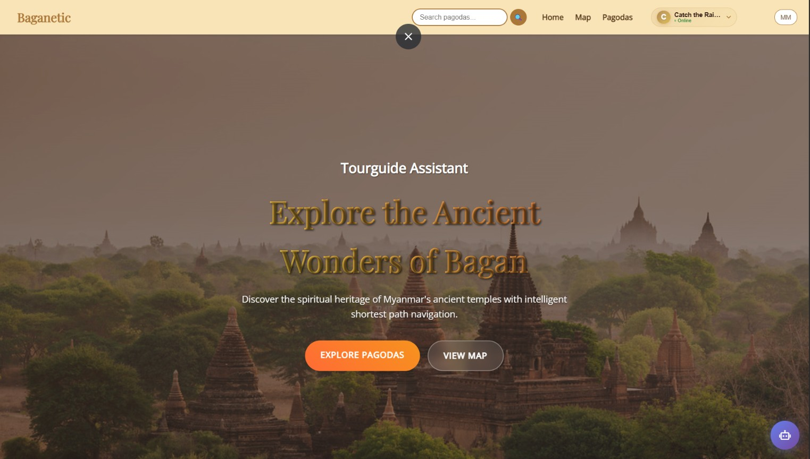
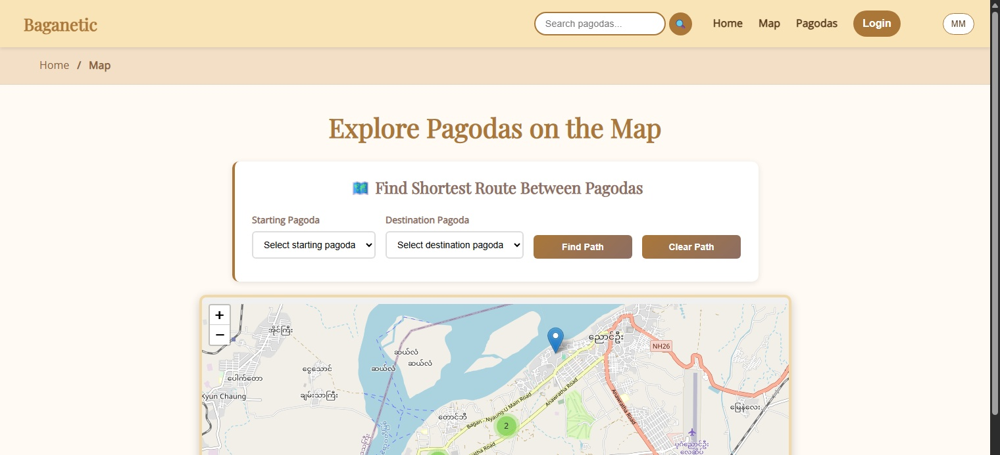
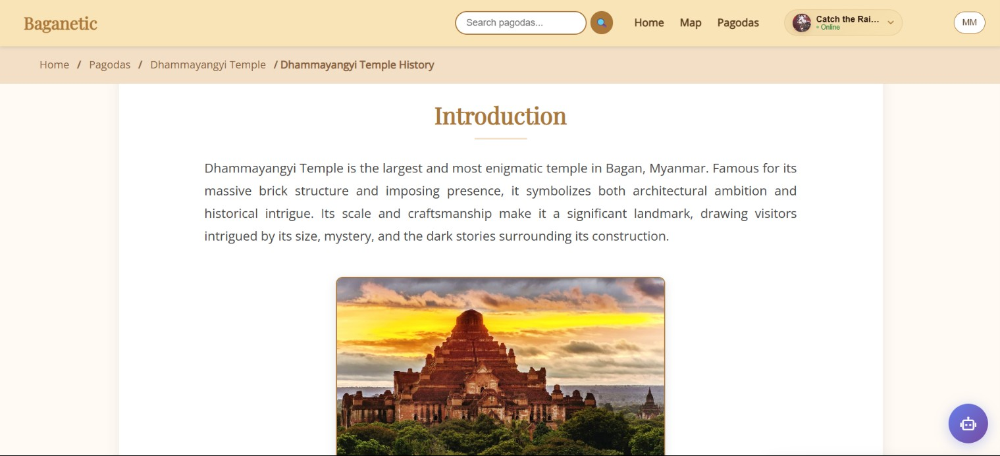
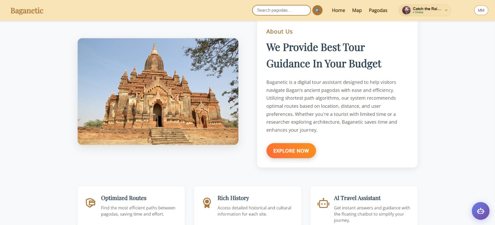

# 🏛️ Baganetic - Bagan Pagodas Guide & Interactive Map

> **Flagship University Special Project (Highest Cohort Grade — Grade A)**  
> An intelligent digital heritage and route-planning platform for exploring Bagan's ancient pagodas. Combines Leaflet spatial mapping, A* shortest-path routing, an AI conversational assistant, and an admin management suite.

[](https://nodejs.org/)
[](https://expressjs.com/)
[](https://python.org/)
[](https://mongodb.com/)
[](https://leafletjs.com/)
[](https://en.wikipedia.org/wiki/A*_search_algorithm)
[](https://github.com/SwordsoulOfLabrynth/Baganetic)

---

## 📸 Visual Showcase

<div align="center">
  
</div>

<br/>

| **Interactive Map & Route Planning** | **Curated Pagoda Directory & Search** |
|:---:|:---:|
|  |  |

| **Pagoda Exploration & Heritage Details** | **About Bagan Heritage & Platform** |
|:---:|:---:|
|  |  |

---

## ✨ Features

### 🗺️ **Interactive Map & Navigation**
- Interactive map showing all pagoda locations
- A* route planning over pagoda nodes, with road-based route visualization when available
- Detailed location information and directions

### 🏛️ **Comprehensive Pagoda Database**
- Detailed information about each pagoda
- Historical background and architectural details
- High-quality images and descriptions
- Search and filter functionality

### 🔐 **User Authentication System**
- Secure user registration and login
- JWT-based authentication
- User profiles and preferences
- Favorites and personal collections

### 🤖 **AI Chatbot Assistant**
- Intelligent conversational AI for pagoda exploration
- Natural language understanding and processing
- Route planning and recommendations
- Cultural and historical insights

### 🛠️ **Admin Dashboard**
- Complete admin interface for content management
- Pagoda CRUD operations (Create, Read, Update, Delete)
- System health monitoring and service management
- Admin activity logs and audit trail

### 📱 **Modern, Responsive Design**
- Mobile-first responsive design
- Beautiful animations and transitions
- Cross-browser compatibility
- Accessibility features

## 🚀 One-Click Installation (Recommended)

### For Windows Users - Super Easy Setup!

1. **Download and extract** the project files
2. **Double-click `setup.bat`** and follow the prompts
3. **Wait for automatic installation** (5-10 minutes)
4. **Double-click `START.bat`** to launch the application

**That's it!** The installer automatically handles everything:
- ✅ Installs Python packages
- ✅ Installs Node.js and npm packages  
- ✅ Installs and configures MongoDB
- ✅ Sets up the database with sample data
- ✅ Configures all environment settings
- ✅ Opens your browser to the application

### Manual Installation (Advanced Users)

**Prerequisites:**
- **Python** (v3.8 or higher)
- **Node.js** (v14 or higher) - Optional
- **MongoDB** (v4.4 or higher) - Optional
- **Git** (for cloning)

**Steps:**
1. **Clone the repository**
   ```bash
   git clone <repository-url>
   cd Baganetic
   ```

2. **Quick Start (All Services)**
   ```bash
   # Windows
   scripts/start_all.bat
   
   # Linux/Mac
   python scripts/start_all.py
   ```

3. **Admin Dashboard Only**
   ```bash
   # Windows
   scripts/start_admin.bat
   
   # Linux/Mac
   python scripts/start_admin.py
   ```

## 🛠️ Admin Dashboard

The Baganetic Admin Dashboard provides comprehensive management capabilities for the entire system.

### Access
- **URL:** http://localhost:5002/admin
- **Default Login:** 
  - Username: `admin`
  - Password: `baganetic2025!`

### Features
- **Dashboard Overview:** System statistics, health monitoring, recent activity
- **Pagoda Management:** Full CRUD operations for pagoda data
- **System Monitoring:** Real-time service health and performance metrics
- **Admin Logs:** Complete audit trail of all admin actions
- **Service Management:** Start/stop/restart system services

### Security
- Session-based authentication with timeout
- Brute force protection (5 attempts = 15min lockout)
- All actions are logged for audit purposes
- Input validation and sanitization

For detailed admin documentation, see [docs/ADMIN.md](docs/ADMIN.md)

## 🔧 Manual Installation

1. **Install dependencies**
   ```bash
   pip install -r requirements.txt
   npm install  # Optional
   ```

2. **Set up environment variables**
   ```bash
   cp env.template .env
   # Edit .env with your configuration
   ```

3. **Start the application**
   ```bash
   # Start all services
   python scripts/start_all.py
   
   # Or start individually
   python app.py              # Main app on port 5000
   python admin_backend.py    # Admin on port 5002
   python chatbot_backend.py  # Chatbot on port 5001
   ```

4. **Open your browser**
   - Main App: `http://localhost:5000`
   - Admin Dashboard: `http://localhost:5002/admin`
   - AI Chatbot: `http://localhost:5001`

## 🔧 Configuration

### Environment Variables
Create a `.env` file in the root directory:

```env
# Server Configuration
PORT=5000
NODE_ENV=development

# Database Configuration
MONGODB_URI=mongodb://localhost:27017/baganetic_users

# Security
JWT_SECRET=your-super-secret-jwt-key-here
SESSION_SECRET=your-session-secret-key-here

# Optional: Email Configuration (for password reset)
SMTP_HOST=smtp.gmail.com
SMTP_PORT=587
SMTP_USER=your-email@gmail.com
SMTP_PASS=your-app-password
```

### Database Setup
The application will automatically create the necessary collections:
- `users` - User accounts and authentication
- `pagodas` - Pagoda information and data

## 📁 Project Structure

```
Baganetic/
├── docs/                    # Documentation
├── scripts/                 # Startup scripts
├── assets/                  # Frontend assets
│   ├── css/                # Stylesheets
│   ├── js/                 # JavaScript files
│   ├── images/             # Images and icons
│   └── data/               # Pagoda data files
├── templates/               # HTML templates
├── app.py                  # Main Flask application
├── admin_backend.py        # Admin system
├── chatbot_backend.py      # AI chatbot
├── server.js               # Node.js server (optional)
├── package.json            # Dependencies and scripts
├── requirements.txt        # Python dependencies
└── README.md              # This file
```

For detailed project structure, see [docs/PROJECT_STRUCTURE.md](docs/PROJECT_STRUCTURE.md)

## 🎯 Usage

### For Users
1. **Browse Pagodas**: Explore the comprehensive pagoda database
2. **Interactive Map**: Use the map to find and navigate between pagodas
3. **Create Account**: Register to save favorites and access personalized features
4. **User Profile**: Manage your account and preferences

### For Developers
1. **API Endpoints**: RESTful API for pagoda and user data
2. **Authentication**: JWT-based user authentication system
3. **Database**: MongoDB with Mongoose schemas
4. **Frontend**: Vanilla JavaScript with modern CSS

## 🔌 API Endpoints

### Authentication
- `POST /signup` - User registration
- `POST /login` - User login
- `POST /logout` - User logout
- `POST /forgot-password` - Password reset request
- `POST /reset-password` - Password reset

### Pagodas
- `GET /api/pagodas` - Get all pagodas
- `GET /api/pagodas/:id` - Get specific pagoda
- `GET /api/pagodas/featured` - Get featured pagodas
- `GET /api/pagodas/search/:query` - Search pagodas
- `GET /api/pagodas/type/:type` - Filter by type

### AI Chatbot
- `POST /api/chatbot/chat` - Send message to chatbot
- `GET /api/chatbot/history/:user_id` - Get chat history
- `POST /api/chatbot/clear/:user_id` - Clear chat history
- `GET /api/chatbot/pagodas` - Get pagoda data for chatbot
- `GET /api/chatbot/health` - Chatbot health check

## 🛡️ Security Features

- **Password Hashing**: bcryptjs for secure password storage
- **JWT Authentication**: Secure token-based authentication
- **Rate Limiting**: Protection against brute force attacks
- **Input Validation**: Comprehensive form and data validation
- **CORS Protection**: Cross-origin request security
- **Helmet**: Security headers and protection

## 🧪 Testing

### Test Authentication System
1. Open `http://localhost:5000/test-auth.html`
2. Test login, signup, and logout functionality
3. Verify localStorage persistence
4. Check authentication state management

### Test Admin System
1. Open `http://localhost:5002/admin`
2. Login with admin credentials
3. Test pagoda management features
4. Verify system monitoring

## 🚀 Deployment

### Local Development
```bash
npm run dev    # Development mode with auto-reload
npm start      # Production mode
```

### Production Deployment
1. Set `NODE_ENV=production` in environment
2. Configure production MongoDB connection
3. Set strong JWT and session secrets
4. Use PM2 or similar process manager
5. Configure reverse proxy (nginx/Apache)

## 🤝 Contributing

1. Fork the repository
2. Create a feature branch
3. Make your changes
4. Test thoroughly
5. Submit a pull request

## 📄 License

This project is licensed under the MIT License - see the LICENSE file for details.

## 📚 Documentation

- **[Setup Guide](docs/SETUP.md)** - Complete installation and setup instructions
- **[Admin Documentation](docs/ADMIN.md)** - Admin dashboard guide
- **[Chatbot Documentation](docs/CHATBOT.md)** - AI chatbot features
- **[Project Structure](docs/PROJECT_STRUCTURE.md)** - Detailed file organization

## 🔄 Fallback Mode

If MongoDB installation fails, the app automatically runs in **fallback mode**:
- ✅ Pagoda data loads from JSON files
- ✅ Interactive map and route planning work
- ✅ Basic chatbot functionality
- ❌ No user authentication
- ❌ No admin features
- ❌ Read-only mode

**To enable full features:** Install MongoDB manually and restart the application.

## 🆘 Support & Troubleshooting

### Quick Fixes
- **"Python not found"** → Install Python 3.8+ and add to PATH
- **"MongoDB failed"** → App runs in fallback mode (limited features)
- **"Port already in use"** → Close other apps using ports 5000, 5001, 5002
- **"Permission denied"** → Run setup.bat as administrator

### Detailed Help
1. Check the console for error messages
2. Verify MongoDB is running (if using)
3. Check environment variable configuration
4. Review the documentation in `docs/` directory
5. Check browser console for JavaScript errors
6. See `INSTALL.txt` for detailed troubleshooting guide

## 🙏 Acknowledgments

- Bagan Archaeological Museum for historical information
- Myanmar Tourism for location data
- Open source community for libraries and tools

---

**Made with ❤️ for exploring the ancient wonders of Bagan**
